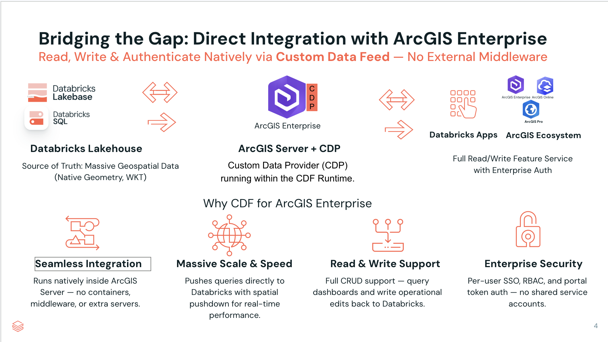
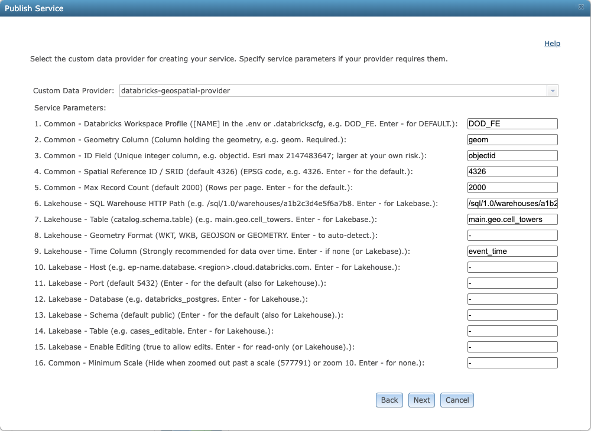
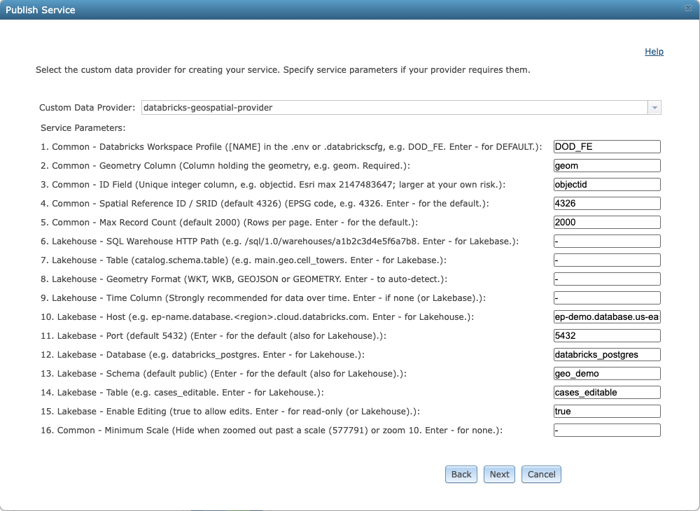

# ArcGIS Custom Data Feed Provider for Databricks

A Node.js Custom Data Provider that publishes Databricks tables as live ArcGIS Server Feature Services. Register it once; each Feature Service picks its backend via service parameters. Two backends:

| Backend | Engine | Best for | Capabilities |
|---------|--------|----------|-------------|
| **Lakehouse** | Databricks SQL Warehouse | Large-scale analytics, complex queries across massive tables | Query |
| **Lakebase** | Databricks Managed PostgreSQL + PostGIS | Low-latency serving (sub-200 ms spatial), interactive maps, feature **editing** | Query + Editing |



> **Getting started:** download the prebuilt package (`.cdpk`), add a `.env` with your Databricks credentials, register it in ArcGIS Server Manager, and create a feature service in Server Manager or your portal. No build step and no JSON: see [Set up in the browser](#set-up-in-the-browser-recommended). Scripts for the same steps are under [Set up from the command line](#set-up-from-the-command-line).

---

## Prerequisites

- **ArcGIS Server 11.4 or later** (12.0+ for editing) with the **Custom Data Feeds runtime** installed. It's a separate install from My Esri.
- **A Databricks SQL Warehouse** (Lakehouse tables) and/or a **Lakebase** database (fast maps, editing).
- **A Databricks token or service principal** with access to your tables, and **outbound access** from ArcGIS Server to Databricks (HTTPS, plus port 5432 for Lakebase).

<details>
<summary><b>Prerequisite details: grants, network, IP access lists</b></summary>

1. **An ArcGIS Server, 11.4 or later, with the Custom Data Feed runtime installed.** The CDF runtime is a **separate** component (not bundled with ArcGIS Server) — install `ArcGIS Custom Data Feeds` for your exact server version from My Esri on every machine (Windows/Linux) and restart, or registration fails. It bundles Node.js (don't install Node separately). Use **12.0+** for feature *editing* (not just read-only maps).
2. **A Databricks SQL Warehouse** for Lakehouse tables (left sidebar → SQL Warehouses), and/or a **Lakebase** database for low-latency maps and editing.
3. **Databricks credentials** — a **Service Principal (OAuth M2M)** (recommended: a machine identity that auto-refreshes, no user dependency) *or* a **Personal Access Token (PAT)** (simplest for one person). Whichever you use, it needs **both** layers of access granted to that same identity:
   - **Compute:** `CAN USE` on the SQL Warehouse.
   - **Data (Unity Catalog):** `USE CATALOG`, `USE SCHEMA`, and `SELECT` on the specific table/view. *(Lakebase: `CONNECT`/`USAGE`/`SELECT`, plus `INSERT`/`UPDATE`/`DELETE` for editing.)* Grant table-level, not catalog-wide.
4. **Outbound network access** from the ArcGIS Server to Databricks:

   | Destination | Port | Used for |
   |---|---|---|
   | `<workspace>.cloud.databricks.com` | 443 | SQL Warehouse queries + Databricks API |
   | `<instance>.database.cloud.databricks.com` | 5432 | Lakebase queries/edits (only if you use Lakebase) |

   If your workspace uses [IP access lists](https://docs.databricks.com/aws/en/security/network/front-end/ip-access-list), add **each** ArcGIS Server node's outbound IP (create your own ALLOW list, and follow your organization's policy for lists managed by someone else, e.g. a platform or security team). Otherwise the connection fails with `HTTP 403`, which surfaces to the publisher as a **misleading `"Service not found"`** — the real `403` appears only in the `Custom_data_feeds` server log. Allow-list changes take a few minutes to propagate.

</details>

---

## Set up in the browser (recommended)

**At a glance**
1. Download one `.cdpk` package.
2. Add a small `.env` file with your Databricks connection to it.
3. Upload it in ArcGIS Server Manager and restart ArcGIS Server.
4. Fill in a form to publish a feature service.
5. Open the service to confirm it works.

No command line needed, except on macOS/Linux to add the file to the package (one command).

### 1. Download the provider package

Download the `.cdpk` for your ArcGIS Server from the [latest release](https://github.com/anandtrivedi/esri-customdatafeed/releases/latest), then **rename it to `databricks-geospatial-provider.cdpk`** (ArcGIS only accepts that name).

| ArcGIS Server | Package |
|---|---|
| 12.0, 12.1 | `databricks-geospatial-provider-12.x.cdpk` |
| 11.4 and later 11.x | `databricks-geospatial-provider-11.x.cdpk` |

### 2. Add your Databricks connection (`.env`)

Create a text file named `.env` with your workspace's host and a token. The name in brackets is what you'll enter when publishing:

```ini
[DOD_FE]
host  = dod-fe.cloud.databricks.com
token = dapiXXXXXXXX
```

Add it to the top level of the package, next to `cdconfig.json`. Don't extract the package and zip it up again; ArcGIS rejects that. Keep this `.env`: you'll add it to every future package when you upgrade.

<details>
<summary><b>How to add the <code>.env</code> to the package (Windows, macOS, Linux)</b></summary>

**Windows (File Explorer):**
1. Turn on *View → Show → File name extensions*.
2. Rename `databricks-geospatial-provider.cdpk` to `.zip` and open it.
3. Drag `.env` into the top level, next to `cdconfig.json`. When upgrading, accept the prompt to replace the old one.
4. Rename it back to `databricks-geospatial-provider.cdpk`.

In Notepad, save with *Save as type: All files*, or the file becomes `.env.txt`.

**macOS / Linux**, in a terminal in the folder holding both files:

```bash
zip databricks-geospatial-provider.cdpk .env                                     # adds or replaces .env
unzip -l databricks-geospatial-provider.cdpk | grep -E ' (cdconfig\.json|\.env)$'   # both should be listed
```

(macOS Finder can't add a file to a zip in place. On Linux, install `zip` if it's missing, or do this on your workstation. Windows PowerShell: see [the command-line section](#add-the-env-with-powershell-windows).)

</details>

<details>
<summary><b>Full <code>.env</code> example: several workspaces, service principal, default, settings</b></summary>

One `[NAME]` section per Databricks workspace:
- each has a `host`;
- plus **either** a `token` (personal access token) **or** a `client_id` + `client_secret` (service principal; recommended for production);
- an optional `[DEFAULT]` section is used by services published with `-` as the workspace.

Single-line `KEY=value` settings go above the first section.

```ini
# Optional settings (single-line KEY=value) go above the first section.
# Max SQL-warehouse connections per ArcGIS machine (default 10):
DATABRICKS_POOL_MAX=20

# Service principal (OAuth M2M), recommended for production
[DOD_FE]
host          = dod-fe.cloud.databricks.com
client_id     = <service-principal-client-id>
client_secret = <service-principal-secret>

# Personal access token
[WEST]
host  = west.cloud.databricks.com
token = dapiXXXXXXXX

# Used by services published with "-" as the workspace
[DEFAULT]
host  = main.cloud.databricks.com
token = dapiYYYYYYYY
```

- Put comments on **their own lines**: in `token = x # note`, the `# note` becomes part of the token. A `# note` after `[NAME]` is fine.
- Save as **UTF-8**; a BOM is fine. Quotes around values are optional. Quote a setting whose value contains `#`.
- A mistyped header such as `[WEST] - prod`, or a stray line inside a section, is an error naming the file and line.
- Section keys never become environment variables. Only the `KEY=value` lines above the first section do.

**Optional settings** (above the first section; the full list is under [Environment variables](#reference)):

| Setting | Default | Raise or set it when |
|---|---|---|
| `DATABRICKS_POOL_MAX` | 10 | Many users or map layers hit Lakehouse services at once and requests fail with `Connection acquisition timeout`. Each connection runs one warehouse query, so make sure the warehouse can take that many concurrent queries. |
| `DATABRICKS_POOL_MIN` | 2 | You want more connections kept warm after a restart. |
| `DATABRICKS_MAX_RECORD_COUNT` | 2000 | You want a bigger default page size for services whose Max Record Count is `-`. Prefer raising it per service (see step 4). |
| `DATABRICKS_QUERY_TIMEOUT` | 120000 (ms) | Legitimate queries need longer than 2 minutes. |
| `DATABRICKS_TILE_QUERY_TIMEOUT` | 30000 (ms) | Map tiles on a slow table are cancelled too early. |
| `LAKEBASE_PASSWORD` / `LAKEBASE_USER` | not set | You use a fixed Lakebase login instead of automatic tokens. It applies to every Lakebase service in the site. |

</details>

### 3. Upload it in Server Manager and restart

In **ArcGIS Server Manager** (`https://<server>:6443/arcgis/manager`), go to **Site → Custom Data Feeds → Add Custom Data Provider**, upload `databricks-geospatial-provider.cdpk`, then **restart ArcGIS Server** on every machine in the site.

<details>
<summary><b>How to restart, upgrading, and cleaning up the upload</b></summary>

- **Restart:** on Windows, use the *Services* app → **ArcGIS Server** → *Restart*. On Linux, run `sudo systemctl restart arcgisserver` (the unit may be named `arcgis-server`), or, as the `arcgis` user, `stopserver.sh` then `startserver.sh` from the install folder. The provider reads its code and credentials at startup.
- **Upgrading:** use the provider's **update** in the same place instead of Add.
- **File picker:** it sees only the machine your browser runs on, so have the `.cdpk` there.
- **Clean up:** delete the upload so no extra copy of your credentials is kept: Server Administrator (`https://<server>:6443/arcgis/admin`) → *uploads* → the item → *delete*.

</details>

### 4. Publish a feature service

> **Note:** published services are readable by anyone who can reach the server unless you restrict them; see [Hardening for Production](#hardening-for-production).

Fill in the form, entering `-` in any field that doesn't apply. For **Workspace Profile**, enter the name in brackets from your `.env` (e.g. `DOD_FE`).

**In ArcGIS Server Manager:** **Services → Publish Service → From a registered custom data provider** → pick **databricks-geospatial-provider** → fill the form → **Next** → name → **Publish**.

**In the ArcGIS Enterprise portal** (federated servers): **Content → My content → New item → Feature layer → Use a custom data provider** (menu names can differ slightly between versions) → pick **databricks-geospatial-provider** → fill the form (each field's ⓘ shows a hint) → **Save**.

| Lakehouse (SQL Warehouse) | Lakebase (PostgreSQL, editable) |
|---|---|
|  |  |

<details>
<summary><b>Field-by-field examples</b></summary>

| # | Field | Lakehouse service | Lakebase service |
|---|---|---|---|
| 1 | Databricks Workspace Profile | `DOD_FE` | `DOD_FE` |
| 2 | Geometry Column | `geom` | `geom` |
| 3 | ID Field (unique integer) | `objectid` | `objectid` |
| 4 | SRID | `4326` | `4326` |
| 5 | Max Record Count | `2000` | `2000` |
| 6 | SQL Warehouse HTTP Path | `/sql/1.0/warehouses/a1b2c3d4e5f6a7b8` | `-` |
| 7 | Table (catalog.schema.table) | `main.geo.cell_towers` | `-` |
| 8 | Geometry Format | `-` (auto-detect) | `-` |
| 9 | Time Column | `event_time` | `-` |
| 10 | Lakebase Host | `-` | `ep-demo.database.us-east-1.cloud.databricks.com` |
| 11 | Lakebase Port | `-` | `5432` |
| 12 | Lakebase Database | `-` | `databricks_postgres` |
| 13 | Lakebase Schema | `-` | `geo_demo` |
| 14 | Lakebase Table | `-` | `cases_editable` |
| 15 | Enable Editing (12.0+) | `-` | `true` |
| 16 | Minimum Scale | `-` | `-` |

- Every field must have a value, which is why `-` exists. For SRID and Max Record Count, `-` gives the defaults (4326, 2000).
- **Max Record Count** is the page size; clients fetch further pages on their own. Raise it to 5,000–15,000 for dense point layers that show "not drawn completely" at map scale, and set a **Minimum Scale** with it so clients don't request a whole continent. Bigger pages mean fewer Lakehouse queries but larger responses.
- **Workspace Profile** is case-sensitive; `-` uses `[DEFAULT]`.
- Set a Lakehouse **Time Column** for any table with history: without one, clients request every date in each map tile.
- In the portal, you need privileges to create content and publish server-based layers, and item sharing controls who sees the layer.

</details>

### 5. Check it works

Open the service's FeatureServer URL and add `/0/query?where=1=1&returnCountOnly=true&f=json`. A count means it works. Then add the layer to a map in Map Viewer. Errors? See [Troubleshooting](#troubleshooting).

### Upgrading, security and other credential options

**Upgrading.** Every provider update replaces the provider folder with the uploaded package, so the `.env` must be in **every** package you upload:
1. Keep your `.env` somewhere safe.
2. Add it to each new `.cdpk` (step 2).
3. Upload it as an **update** and restart (step 3).

**Verifying the download.** Each release file has a `.sha256` next to it. The same packages are also in [`cdpk/12.x`](cdpk/12.x) and [`cdpk/11.x`](cdpk/11.x).

Changing a credential works the same way.

**Security.** With a `.env`, the secrets travel inside the package:
- ArcGIS keeps a copy of the registered package in its config store and extracts it on every machine. ArcGIS administrators can read it, and it's included in backups.
- Each upload stays under `arcgisuploads/` until you delete it (step 3, *Clean up*).
- Provider-folder backups taken before an update still hold the old `.env`.

Use a service principal with only the grants it needs ([Prerequisites](#prerequisites)). To rotate a secret:
1. Create the new secret.
2. Upload a package with the new `.env`, restart, and check that a service still answers.
3. Only then **revoke the old secret in Databricks**.

<details>
<summary><b>Alternative: a <code>.databrickscfg</code> on each machine (keeps secrets out of the package)</b></summary>

The provider also reads a standard `.databrickscfg`, auto-found at `/home/arcgis/.databrickscfg` (Linux) or `%ProgramData%\ArcGIS\cdf\.databrickscfg` (Windows). Set `DATABRICKS_CONFIG_FILE` only if it lives elsewhere. It has the same `[NAME]` sections as the `.env`. A profile with the same name as a `.env` section **wins on that machine**, which can make machines behave differently.

- **Linux:** `sudo bash configure-databricks.sh` writes it owned by `arcgis`, mode `600`, keeping existing profiles. Or by hand:

  ```bash
  databricks configure --token          # asks for Host + PAT; writes ~/.databrickscfg [DEFAULT]
  sudo cp ~/.databrickscfg /home/arcgis/.databrickscfg
  sudo chown arcgis:arcgis /home/arcgis/.databrickscfg
  sudo chmod 600 /home/arcgis/.databrickscfg
  ```

- **Windows:** `windows\configure-databricks.ps1` writes `C:\ProgramData\ArcGIS\cdf\.databrickscfg`, locked with an `icacls` ACL.

This file is **per machine**: put it on **every** machine in the site, or the others return intermittent 404s. Restart ArcGIS Server after changes.

</details>

<details>
<summary><b>Alternative: environment variables (one default workspace)</b></summary>

Set `DATABRICKS_SERVER_HOSTNAME` plus either `DATABRICKS_ACCESS_TOKEN`, or `DATABRICKS_CLIENT_ID` + `DATABRICKS_CLIENT_SECRET`:
- **Linux:** in `init_user_param.sh`.
- **Windows:** as machine environment variables. These are readable by **every local account**.

They serve only services published without a workspace name, and only when no `[DEFAULT]` section exists. Restart ArcGIS Server after changes.

</details>

<details>
<summary><b>Service principal setup, lookup order and troubleshooting</b></summary>

**Service principal setup** (Databricks account console):
1. Create the SP and assign it to the workspace.
2. Generate an OAuth secret (`client_id` / `client_secret`).
3. Grant `CAN USE` on the warehouse, plus Lakebase access if used.

Each profile uses **one** auth mode and gets its own connection pool. For Lakebase over OAuth M2M, the provider exchanges `client_id`/`client_secret` at `/oidc/v1/token`, then mints Lakebase tokens and refreshes them about 5 minutes before they expire. Ref: [OAuth M2M](https://docs.databricks.com/aws/en/dev-tools/auth/oauth-m2m).

**Lookup order:**
- A service with a workspace name uses that name from the machine's `.databrickscfg`, else from the `.env`. If neither has it, its requests fail with `workspace profile "…" not found` and the list of available profiles.
- A service without one (`-`) uses `[DEFAULT]` (`.databrickscfg` first, then `.env`), then the environment variables.

| Symptom | Likely cause |
|---|---|
| `workspace profile "X" not found` (lists the available profiles) | Name typo (case-sensitive); `.env` missing from the uploaded package; ArcGIS Server not restarted; wrong `DATABRICKS_CONFIG_FILE` |
| Error naming the `.env` and a line number | A mistyped `[NAME]` header, or a stray line inside a section |
| `Profile [X] … is ambiguous` | Both a token and a client id/secret in one profile; pick one |
| `OAuth M2M token endpoint returned 401` | SP secret wrong or revoked, or SP not assigned to the workspace |
| Authentication fails though the secret looks right | A `# comment` at the end of the value line became part of the value |
| Works on some machines, fails on others | A `.databrickscfg` on some machines overrides the `.env` profile, or `.databrickscfg` exists on only some machines |
| `Source IP … blocked by Databricks IP ACL` | ArcGIS Server's outbound IP isn't on the workspace allowlist |

</details>

<details>
<summary><b>Lakebase backend setup</b> (skip if you only use Lakehouse)</summary>

Enable PostGIS on each database: `CREATE EXTENSION IF NOT EXISTS postgis;` (without it the first query fails with `function st_intersects does not exist`). Per-table connection details go on each service at publish time.

Auth is automatic. The provider mints short-lived Lakebase OAuth tokens for both **Autoscaling** endpoints and Provisioned instances. It signs in as the workspace identity: the service principal's client id for an OAuth M2M profile, or the token owner for a PAT profile.
- In a workspace with many Lakebase projects, set `LAKEBASE_ENDPOINT_NAME=projects/<p>/branches/<b>/endpoints/<e>` to skip the endpoint lookup.
- To use a fixed credential instead, set `LAKEBASE_PASSWORD` (+ `LAKEBASE_USER`) as `.env` settings above the first section (applies to **every** Lakebase service on **every** machine in the site), or in `init_user_param.sh` (that machine only).

> **Synced Tables caveat** (checked 2026-10-12 against the [synced tables docs](https://docs.databricks.com/aws/en/oltp/projects/sync-tables); re-check there): Databricks Sync (UC → Lakebase) does **not** carry `GEOMETRY`/`GEOGRAPHY` columns, and synced tables are read-only in Postgres. Sync the geometry as WKT text and publish a view that converts it; see [Known Limitations](#known-limitations).

</details>

---

<br>

> ### ✅ That's it. You're set up.
> Everything below is optional reference: the same setup from the command line, hardening, troubleshooting and details.

---

## Set up from the command line

Everything in [Set up in the browser](#set-up-in-the-browser-recommended) can also be scripted. Credentials work the same way (a `.env` in the package, or a `.databrickscfg` per machine).

### Guided wizard (Linux)

Everything runs **on the ArcGIS Server host** (SSH in first), except registering the provider, which you can do in the browser-based Server Manager. The guided **`setup.sh`** wizard does the whole install: it prechecks the environment, then opens a menu — for a fresh box choose **option 5 (Full first-time setup)**, which chains **configure → register → publish** (configure first, so the provider reads your credentials when the register step restarts it) using an ArcGIS admin login it collects once.

```bash
# 0. Get the code onto the ArcGIS Server host (it carries the wizard + the provider source).
git clone <this-repo-url> && cd esri-customdatafeed

# 1. Run the guided wizard — as ROOT (recommended) or the arcgis user (NOT a plain user).
sudo bash setup.sh          # opens a menu -> pick 5 (Full first-time setup): configure -> register -> publish

# 2. If a step ever misbehaves, the read-only health check tells you why:
sudo bash diagnose-service.sh

# 3. Publish more tables later, one wizard per table:
sudo bash publish-service.sh
```

`setup.sh`'s Register step **auto-detects a prebuilt `.cdpk`** sitting next to the scripts and registers it — so on any box (including **air-gapped** ones) you can download the release `.cdpk` (or build it on a connected machine), drop it in, and the wizard registers it with no npm/build. Only if no prebuilt is found *and* the box has npm + registry access does it build one for you instead — see [Manual Setup](#build-the-package-from-source). On a **federated** ArcGIS Enterprise it offers Portal-specific guidance under **menu option `F`** (which appears only when a federated Enterprise is detected). For **fully disconnected** environments (no Internet, artifact moved in via an approved path or an internal repo), see **[AIRGAP-INSTALL.md](AIRGAP-INSTALL.md)**.

> **The Databricks CLI** (optional) can write a `.databrickscfg` and helps look up values the publish wizard asks for. Install on the server: `curl -fsSL https://raw.githubusercontent.com/databricks/setup-cli/main/install.sh | sh`. *(No internet on the box? It's one static binary — download it elsewhere and copy it onto the `PATH`.)*

> **Running ArcGIS Server on Windows?** These scripts are bash (Linux). Pure-PowerShell ports of the register + configure steps — no Git Bash or WSL needed — live in **[`windows/`](windows/README.md)**. Build the `.cdpk` on Linux or a build box and copy it over; one package runs on any platform.

> **Which user runs what:** your SSH user (e.g. `ubuntu`) runs the **build** (`git`, `npm`, `zip`). But the **`.sh` helper scripts** — `setup.sh`, `register-provider.sh`, `configure-databricks.sh`, `publish-service.sh`, `diagnose-service.sh` — must run as **root (`sudo bash …`)** or the **`arcgis`** user: a plain user can't restart the server or read the mode-600, `arcgis`-owned `/home/arcgis/.databrickscfg`. `sudo -u arcgis` starts/stops the server (it runs as the `arcgis` OS user): `sudo -u arcgis /opt/arcgis/server/startserver.sh`. Files you create under the install tree should be `chown arcgis:arcgis`.
>
> **Install root:** Linux defaults to `/opt/arcgis/server/`, but hardened sites often use `/app/arcgis/server/` — check `ls -d /opt/arcgis /app/arcgis 2>/dev/null` and substitute yours. (`setup.sh` and `register-provider.sh` auto-detect `/opt`, `/app`, and home-directory installs; hand-typed commands below do not.)

### Add the `.env` with PowerShell (Windows)

```powershell
Rename-Item databricks-geospatial-provider.cdpk databricks-geospatial-provider.zip
Compress-Archive -Path .env -DestinationPath databricks-geospatial-provider.zip -Update
Rename-Item databricks-geospatial-provider.zip databricks-geospatial-provider.cdpk
# check: both cdconfig.json and .env are listed
Add-Type -AssemblyName System.IO.Compression.FileSystem
[IO.Compression.ZipFile]::OpenRead("$PWD\databricks-geospatial-provider.cdpk").Entries.FullName -match '^(cdconfig\.json|\.env)$'
```


### Build the package from source

Only for a custom version, a code change, or a box that can't download the release.

The provider source lives in the **`nodejs-provider/`** subdirectory. `node_modules/` isn't shipped, so this is the one step that needs a package registry (everything after it is air-gap-friendly).

```bash
cd esri-customdatafeed/nodejs-provider
npm install
# Package as a .cdpk (a zip with a different extension). Keep the excludes EXACTLY as written.
zip -r databricks-geospatial-provider.cdpk \
  cdconfig.json package.json package-lock.json src/ node_modules/ \
  -x '.env' '.env.*' 'test/*' '*.md'
```

> ⚠️ **Don't broaden the excludes to `*.env*`** — it would strip `node_modules` files whose names contain `.env` (a transitive dep of `@databricks/sql`) and the package fails to register.

<details>
<summary><b>Air-gapped, GovCloud, or a broken <code>npm</code> launcher</b></summary>

- **Build anywhere, run on the server.** The provider has **no *required* native modules** — its one native dep (`lz4`) is optional and the driver runs fine without it — so a `.cdpk` built on any OS/arch loads on the Linux server. For a fully offline box, build the `.cdpk` on any machine with registry access, copy it over, and register it via the GUI or `register-provider.sh` **option 2**.
- **GovCloud (`.databricks.mil` / `.databricks.us`) + OAuth M2M:** the bundled `@databricks/sql` hardcodes an OAuth domain allowlist and throws `OAuth is not supported for <host>` on GovCloud. Either **use a PAT** (skips OAuth entirely, works unchanged), or let **`register-provider.sh`'s build (option 1)** widen the allowlist automatically (it re-adds `.mil`/`.us` after `npm install` and fails the build if that didn't take). The widening is outbound-only.
- **`npm` errors with `Cannot find module '../lib/cli.js'`:** the ArcGIS-bundled npm launcher is broken on some installs. Invoke npm through the bundled Node directly (prefix with `sudo -u arcgis` if the binary is owned by `arcgis`):
  ```bash
  /opt/arcgis/server/framework/runtime/node/bin/node \
    /opt/arcgis/server/framework/runtime/node/lib/node_modules/npm/bin/npm-cli.js install
  ```

</details>

<details>
<summary><b>Rebuilding an 11.x package</b></summary>

The prebuilt `cdpk/11.x/` package already covers **11.2 → 11.5+**. To rebuild for a custom version, start from the 12.x manifest (`cdconfig.json`) and: set `arcgisVersion` to **`11.2.0`** (the floor — registers across the whole 11.x line), keep the top-level `editingEnabled`, add `properties.hosts: false` + `properties.disableIdParam: true`, and add a `config/default.json` = `{}` file to the zip (the 11.x CDF runtime requires all three; 12.x auto-defaults them). Windows: `windows/build-cdpk.ps1 -ArcgisVersion 11.2` (plus the config/hosts additions). Register the version-matched package on each server — the 11.x manifest is for 11.x servers, the `12.x` package for 12.x.

</details>

### Register by script or REST

`sudo bash register-provider.sh` does Build + Register in one wizard (build via option 1, or register an existing `.cdpk` via option 2), auto-detects the install root, updates-vs-registers safely (snapshotting the live provider dir so a failed update can be rolled back), and restarts the server.

<details>
<summary><b>Register without the GUI (CLI / Admin REST API)</b></summary>

**ArcGIS Enterprise SDK `cdf` CLI** — `cdf register databricks-geospatial-provider.cdpk https://your-server:6443/arcgis/admin` (prompts for `siteadmin`; for self-signed certs set `NODE_EXTRA_CA_CERTS`).

**Admin REST API** — `TOKEN` here is an *ArcGIS Server admin token* (not your Databricks token); `client=requestip` binds it to your IP so no `Referer` header is needed:

```bash
# (a) Mint the admin token (run on the box).
TOKEN=$(curl -sk -X POST 'https://localhost:6443/arcgis/admin/generateToken?f=json' \
  --data-urlencode 'username=siteadmin' --data-urlencode 'password=...' \
  --data-urlencode 'client=requestip' \
  | python3 -c 'import sys,json; print(json.load(sys.stdin)["token"])')
# (b) Upload the .cdpk — the response contains an itemID.
curl -k "https://localhost:6443/arcgis/admin/uploads/upload?token=$TOKEN&f=json" \
  -F "itemFile=@databricks-geospatial-provider.cdpk"
# (c) Register it (first install only; use /update to upgrade).
curl -k "https://localhost:6443/arcgis/admin/services/types/customdataproviders/register?token=$TOKEN&f=json" \
  --data-urlencode "id=ITEM_ID_FROM_UPLOAD_RESPONSE"
```

</details>

<details>
<summary><b>Upgrading or removing the provider later</b></summary>

Registering an existing name is refused. Rebuild the `.cdpk`, then use the provider's **edit/update** in the GUI, or via REST call `/customdataproviders/update` (same upload → `update` instead of `register`). Restart afterward.

**A failed `update` deletes the live provider directory** and your services 404 until a good package is registered — `register-provider.sh` snapshots the dir first so it can roll back. To retire a provider: `/customdataproviders/unregister` with `--data-urlencode "customdataFilename=old-provider-name.cdpk"`.

Registration extracts the `.cdpk` into `<install>/server/framework/runtime/customdata/providers/…` — credentials in `/home/arcgis/.databrickscfg` live outside that dir and survive re-registration.

</details>

### Publish with `publish-service.sh`

One `publish-service.sh` run per session; it builds the `createService` payload for you, with no JSON to write and no admin token to mint.

```bash
cd ~/esri-customdatafeed        # the repo root (not nodejs-provider/)
sudo bash publish-service.sh
```

It runs these steps:
1. Preflights: is the provider registered, and are credentials in place?
2. Offers the workspace profiles from the provider's `.env` and the machine's `.databrickscfg`.
3. Lets you pick the **backend**.
4. Asks for the warehouse or Lakebase connection **once**, then **loops per table**.
5. Prompts for **instance sizing** (`min=1`/`max=2` by default, a warm instance per node to avoid the intermittent-404 cold start) and optional **Advanced** visibility/idle settings.
6. **Creates → starts → verifies** each service, then prints its FeatureServer URL and an anonymous-access probe.

> To script the raw REST call yourself, see [Manual service creation](#reference) under Reference. To publish from a Databricks agent, see [Agent-Driven Publishing](#agent-driven-publishing-mcp).

---

## Hardening for Production

> **⚠️ Anonymous access:** by default a published CDF Feature Service is **readable by anyone who can reach the server** — no token required. If that's not what you want, mark the service **private** (the `publish-service.sh` Advanced option denies anonymous `esriEveryone` access), and confirm with the anonymous-access probe the wizard prints. On **federated** ArcGIS Enterprise, access is governed by **Portal item sharing**, not the server's `esriEveryone` lever — set the item's sharing there.

**A standard install needs nothing here**: credentials come from the `.env` in the package, or a `.databrickscfg` the provider auto-finds. `init_user_param.sh` (typically `/opt/arcgis/server/usr/init_user_param.sh`) is only for **overrides**: a credential file in a non-standard location, or optional tuning.

```bash
# Only if your .databrickscfg is NOT at ~/.databrickscfg or /home/arcgis/.databrickscfg:
export DATABRICKS_CONFIG_FILE=/shared/path/.databrickscfg
# Optional default SQL Warehouse (the publish wizard sets it per-service):
export DATABRICKS_HTTP_PATH=/sql/1.0/warehouses/your-warehouse-id
```

Restart ArcGIS Server after editing it. Keep credentials in the `.env` or `.databrickscfg`, not here.

<details>
<summary><b>Optional tuning knobs & admin-token binding (requestip vs referer)</b></summary>

Tuning (leave at defaults unless needed): `DATABRICKS_MAX_RECORD_COUNT`, `DATABRICKS_QUERY_TIMEOUT`, `DATABRICKS_USE_CLOUDFETCH`, `DATABRICKS_TILE_QUERY_TIMEOUT`, `DATABRICKS_MAX_RETURN_IDS`, `DATABRICKS_MAX_DISTINCT_ROWS`, `LAKEBASE_STATEMENT_TIMEOUT_MS`, `ENABLE_AUDIT_LOG`, pool sizes — see [Environment Variables](#reference).

**Admin-token binding:** `client=requestip` (used throughout this guide) ties the token to your IP — no `Referer` header on admin calls, simplest on the box. `client=referer` ties it to a URL and **every** admin call must send a matching `Referer` header (mismatch → `HTTP 498`). Note: a feature-service `/query` validates more strictly and may reject a `requestip` token — query it with a `referer`-bound token **plus** a matching `Referer` header (the publish wizard does this for its verify step).

</details>

---

## Supported Operations

**Query (both backends):** `where`, `objectIds`, `geometry`+`spatialRel` (intersects/contains/within/crosses/overlaps/touches), `outFields`, `resultRecordCount`+`resultOffset`, `orderByFields`, `returnCountOnly`, `returnGeometry`. **Lakehouse also:** `returnDistinctValues`, `time` (needs `timeColumn`), and multiple geometry storage formats.

**Editing (Lakebase only, `applyEdits`):** Add (auto-generated IDs), Update (by OBJECTID), Delete (per-row failure reporting). Set `rollbackOnFailure=true` to wrap all ops in one transaction. Requires `capabilities: "Query,Editing"` + `editingEnabled: "true"` at publish, and ArcGIS Server 12.0+.

---

## Performance: Lakebase vs Lakehouse

Benchmark on 17M Overture Maps Places, warm averages, end-to-end through ArcGIS Server REST:

| Query Type | Lakebase | Lakehouse | Speedup |
|---|---|---|---|
| Spatial: city block (~1k) | **120 ms** | 3,566 ms | **29.7×** |
| Spatial: DC metro (~2k) | **152 ms** | 4,466 ms | **29.4×** |
| Spatial count (DC metro) | **185 ms** | 2,197 ms | **11.9×** |
| objectIds lookup (5) | **32 ms** | 357 ms | **11.2×** |
| Attribute `LIKE '%Starbucks%'` | **47 ms** | 499 ms | **10.6×** |
| COUNT (full table) | 636 ms | **150 ms** | Lakehouse 4.2× |

**Lakebase is 8–30× faster for spatial** (PostGIS GIST indexes vs file-level scanning) and all queries are sub-200 ms (interactive). **COUNT is the one case Lakehouse wins** (columnar stats). Config: Lakebase CU_4 + GIST, Lakehouse Large Serverless (Z-ordered), ArcGIS 12.0 on m5.xlarge.

---

## Working with Existing Tables

**Already have a geometry column?** Point `geometryColumn` at it (any supported format; set `geometryFormat` if the name doesn't make it obvious).

**Only `latitude`/`longitude` columns?** Create a view and point the service at it:

```sql
-- Lakehouse
CREATE VIEW catalog.schema.my_table_geo AS
SELECT *, ST_Point(longitude, latitude, 4326) AS geometry   -- lon, lat, SRID
FROM catalog.schema.my_table WHERE latitude IS NOT NULL;

-- Lakebase
CREATE VIEW public.my_table_geo AS
SELECT *, ST_SetSRID(ST_MakePoint(longitude, latitude), 4326) AS geometry
FROM public.my_table WHERE latitude IS NOT NULL;
```

> **⚠️ Always stamp the SRID.** Databricks `ST_Point(lon, lat)` / `ST_GeomFromText(wkt)` **default to SRID 0**, which ArcGIS can't project — features come back with attributes but **no geometry**. Use `ST_Point(lon, lat, 4326)` (or `ST_SetSRID(…, 4326)`) so the column reads `geometry(4326)`, matching the service's `srid` param. (Details in [Troubleshooting](#troubleshooting).)

---

## Troubleshooting

**`workspace profile "…" not found`**, followed by the profiles the provider found: an empty list means the `.env` isn't in the uploaded package; old names after an update mean ArcGIS Server wasn't restarted. Other credential errors are in the table under [Service principal setup, lookup order and troubleshooting](#upgrading-security-and-other-credential-options).

> **Fastest first step: `sudo bash diagnose-service.sh`.** A read-only health check — give it a service name and it reports the provider, service state, `min/max` instances, `tableName`/`idField`/geometry, per-machine instance stats, a live query smoke test, and a plain-English assessment. It flags the common failures automatically (stopped service, `minInstancesPerNode=0` intermittent-404, federated token contract). On a federated server it can mint a Portal token for a definitive query if you give it a Portal login.

<details>
<summary><b>Register/update fails, or "Cannot find module '../adapters/process.env'"</b></summary>

Your `.cdpk` was built with an overbroad exclude (e.g. `-x '*.env*'`) that stripped `node_modules` files. Rebuild with the exact excludes from [Build the package from source](#build-the-package-from-source). A failed `update` deletes the live provider dir — upload a good `.cdpk`, run `update` again, restart.

</details>

<details>
<summary><b>Service shows STARTED in admin but HTTP 404 from REST</b></summary>

Provider init failed silently. Tail the server log for `Custom_data_feeds` lines — usually a missing/expired credential, a `.databrickscfg` profile name mismatch, or an unreachable warehouse. (On a **federated** server a `/query` 404/500 with a *server* token can just be the token contract — verify with a Portal token; `diagnose-service.sh` distinguishes these.)

</details>

<details>
<summary><b>HTTP 498 (Invalid token) / HTTP 403 on first query / timeouts</b></summary>

- **498 on admin calls:** you used `client=referer` without a matching `Referer` header — simplest fix is `client=requestip`. **498 on `/query`:** use a `referer` token + matching header.
- **403 `Source IP … blocked`:** add the ArcGIS Server's outbound IP to the workspace IP access list. **403 `Invalid access token`:** the PAT/SP is expired/revoked — refresh it and restart the server.
- **`ECONNREFUSED`/`ETIMEDOUT`:** a firewall is blocking outbound 443 (or 5432 for Lakebase) — see [Prerequisites](#prerequisites).

</details>

<details>
<summary><b>Intermittent 404 "works on refresh" / no data / OBJECTID issues / editing / slow queries</b></summary>

- **404 that recovers on refresh:** `minInstancesPerNode=0` keeps no warm instance — set `min=1`, `max≥2` (per service; `setup.sh` option 9 does it in place).
- **Updated `.databrickscfg` but change ignored:** the provider caches it at first read — **restart ArcGIS Server** after any edit.
- **No data:** verify the fully-qualified table name + geometry column; test the warehouse independently.
- **OBJECTID:** `idField` must be a unique integer ≤ 2,147,483,647 (see [Known Limitations](#known-limitations) for larger ids). `diagnose-service.sh` checks the range for any service.
- **Editing fails:** `capabilities:"Query,Editing"` + `editingEnabled:"true"` both set; `lakebaseHost` present (editing is Lakebase-only); ArcGIS 12.0+. On federated Portal, the user's role needs "Edit features".
- **Every `applyEdits` answers `Invalid URL`:** the service was published with hosted-layer style capabilities (`Create,Delete,Query,Update`). A Custom Data Feed service needs exactly `Query,Editing` — fix `capabilities` on the service and restart it.
- **Lakebase `password authentication failed for user '<uuid>'` (native login):** with `LAKEBASE_PASSWORD` set, set `LAKEBASE_USER` to the password role — it takes priority over the service principal's client id. (Older builds used the client id on OAuth-M2M profiles.)
- **Slow:** Lakehouse cold start (5–15 s) after idle; add `OPTIMIZE … ZORDER BY (geom)` (Lakehouse) or `CREATE INDEX … USING GIST (geom)` (Lakebase).

</details>

<details>
<summary><b>Features have attributes but no geometry (nothing draws in Portal / Map Viewer)</b></summary>

The source geometry has **SRID 0** (undefined spatial reference). ArcGIS can't project it, so features come back with attributes but null geometry — a raw REST `/query` still returns the attribute rows, which masks the problem and makes it look like a Portal-only issue. Cause: geometry built without an SRID — Databricks `ST_Point(lon, lat)` / `ST_GeomFromText(wkt)` default to **SRID 0**, so the column is `geometry(0)`. Fix: stamp the SRID in the source view/table — `ST_Point(lon, lat, 4326)` or `ST_SetSRID(ST_Point(lon, lat), 4326)` — confirm the column reads `geometry(4326)` (`SELECT DISTINCT ST_SRID(geometry) FROM …`) and matches the service's `srid` param (`4326`). This is a **data** change to the source, so it's picked up on the next query — **no server restart needed** (responses aren't cached; only the geometry *format* — WKT/WKB/GEOMETRY, not SRID — is cached per column, so a restart is only needed if you change the storage *format* or credentials). Just hard-refresh Map Viewer (it caches layer metadata). Note: a *wrong-but-valid* SRID instead renders features in the wrong place (Null Island), not missing.

</details>

<details>
<summary><b>Sanity-check the whole install in one command</b></summary>

```bash
# Set ROOT to your install root (/opt/arcgis default; /app/arcgis on hardened boxes).
sudo ROOT=/opt/arcgis bash -c '
P="$ROOT/server/framework/runtime/customdata/providers/databricks-geospatial-provider"
echo "=== Provider dir ==="; ls -la "$P/"
echo "=== Provider .env (redacted) ==="; [ -f "$P/.env" ] && sed -E "s/(TOKEN|PASSWORD|SECRET) *= *.+/\1=<REDACTED>/g" "$P/.env" || echo "(none)"
echo "=== init_user_param.sh (redacted) ==="; sed -E "s/(TOKEN|PASSWORD|SECRET) *= *.+/\1=<REDACTED>/g" "$ROOT/server/usr/init_user_param.sh" 2>/dev/null
echo "=== .databrickscfg (redacted) ==="; sed -E "s/(token|client_secret) *= *.+/\1 = <REDACTED>/g" /home/arcgis/.databrickscfg 2>/dev/null
echo "=== recent Custom_data_feeds log lines ==="; ls -t "$ROOT"/server/usr/logs/*/server/server-*.log 2>/dev/null | head -1 | xargs grep -E "Custom_data_feeds|Pool " 2>/dev/null | tail -10
'
```

</details>

---

## Known Limitations

**Lakebase Synced Tables don't support GEOMETRY/GEOGRAPHY** (checked 2026-10-12 against the [synced tables docs](https://docs.databricks.com/aws/en/oltp/projects/sync-tables), last updated 2026-10-09: "GEOGRAPHY, GEOMETRY, VARIANT, and OBJECT types are not supported"; re-check that page, this may change). Synced tables are also read-only in Postgres: only `SELECT`, `CREATE INDEX` and `DROP TABLE` are allowed, and any other change breaks the sync.

**Workaround:** store the geometry as WKT in a STRING column of the source Delta table and sync that. Then, in Lakebase, add a view that converts it and publish the **view** as the Lakebase Table (read-only):

```sql
CREATE VIEW geo_demo.my_table_geo AS
  SELECT *, ST_GeomFromText(geometry_wkt, 4326) AS geom FROM geo_demo.my_table;
-- Spatial index on the synced table itself (allowed), matching the view's expression:
CREATE INDEX ON geo_demo.my_table USING GIST (ST_GeomFromText(geometry_wkt, 4326));
```

Tables created directly in Lakebase with native PostGIS geometry work fine.

**PBF feature tiles are on.** Clients get quantized PBF tiles (about 3–9× smaller than JSON), which render in Map Viewer and the JS SDK on ArcGIS 12.1. Versions 1.1.3–1.1.4 turned PBF off after large layers drew blank in Map Viewer; that turned out to be the provider's own Web Mercator tile-geometry bug (fixed in 1.1.3), not the ArcGIS runtime. The old `enablePbf` service parameter is ignored and kept only so existing services validate.

**Set a time column for anything with history.** Without one the layer isn't time-enabled, and Map Viewer and other clients request every date in each tile — a full scan on a large multi-year table, slow enough to back up every service on the server. With one, the provider reports the data's time range (computed once and cached), clients show a time slider, and they query one interval at a time. The publish wizard suggests a DATE/TIMESTAMP column and asks you to confirm before publishing without one.

**idField values above 2,147,483,647.** Esri OBJECTIDs are 32-bit. Larger ids (e.g. 64-bit AIS ids) drew, selected and identified correctly in our own testing, but that range is not supported by Esri — use it at your own risk; the server log shows a one-time warning per field. Above 9,007,199,254,740,991 (2^53 − 1) ids can't be carried exactly: neighbouring ids merge, so selection, identify and edits hit the wrong features. The provider refuses edits on such ids, lookups by them return nothing, and the log shows one error per field. `publish-service.sh` (Lakehouse) and `diagnose-service.sh` warn about both ranges.

**Lakebase layers need at least one row to publish.** Field and geometry types come from the data, so an empty editable table publishes with no fields; add one seed row first.

**Polygons and lines crossing the 180° meridian** are unwrapped on output (negative longitudes shifted by +360 for that shape), so they no longer draw as bands across the map. Filters still run against the stored geometry.

---

## Agent-Driven Publishing (MCP)

 An MCP server (`mcp-server/`) that turns provider setup and per-layer publishing into a conversation — an agent inspects the Unity Catalog table (geometry, SRID, a validated int32 id), publishes it, smoke-tests it, and returns the FeatureServer URL.

<details>
<summary><b>Quickstart & tools</b></summary>

```bash
cd esri-customdatafeed/mcp-server && npm install
claude mcp add databricks-cdf -- node "$(pwd)/bin/cli.js" serve
```

Then, in the client: register your ArcGIS target (password set via a terminal command, never typed into chat) → install the provider → *"publish catalog.schema.my_table"*. Key tools: `register_gis_target`, `provider_status`, `register_provider` (build/install/upgrade, env baked in), `inspect_table`, `create_publish_view`, `publish_layer`, `list_layers`, `unpublish_layer`. Credentials never pass through chat (resolved server-side from `env:`/`secret:` refs). Can be hosted as a Databricks App for Playground/Genie. Full details: [`mcp-server/README.md`](mcp-server/README.md).

</details>

---

## Reference

<details>
<summary><b>Manual service creation (Admin REST API) + parameters</b></summary>

`publish-service.sh` builds and submits this for you. Creating a service is a REST call per table (`/createService`); the presence of `lakebaseHost` selects the backend. Source-table requirements: `idField` is a unique integer 0–2,147,483,647; geometry uses `lon lat` order; Lakehouse table names are fully qualified (`catalog.schema.table`).

**Lakehouse parameters:** `workspace` (profile; default env), `warehouseHttpPath` (default `DATABRICKS_HTTP_PATH`), `tableName` (required), `geometryColumn` (`geometry`), `idField` (`id`), `geometryFormat` (auto: `WKT`/`WKB`/`GEOJSON`/`GEOMETRY`), `timeColumn`, `maxRecordCount` (`2000`), `srid` (`4326`), `minScale` (optional; see below).

**Lakebase parameters:** `workspace`, `lakebaseHost` (required, selects Lakebase), `lakebasePort` (`5432`), `lakebaseDatabase` (required), `lakebaseSchema` (`public`), `lakebaseTable` (required), `geometryColumn`, `idField`, `maxRecordCount`, `srid`, `editingEnabled` (`false`), `minScale`.

**`minScale` (optional, both backends):** the most zoomed-out view at which clients draw the layer, as a scale (`577791`) or a zoom level (`zoom 10`). It's advertised as standard layer metadata, so Map Viewer, Pro and the JS SDK stop requesting features when zoomed out further. For point tables, by row count:

| Rows | Suggested `minScale` |
|---|---|
| under 10 million | none (`-`) |
| 10 million – 1 billion | `zoom 8` |
| over 1 billion, clients send a time window | `zoom 8`–`zoom 10` |
| over 1 billion, clients may not send one | `zoom 11`–`zoom 12` |

Polygon/H3 density layers usually need none.

**Fill one set, not both.** A read-only **Lakehouse** service uses the Lakehouse fields; an editable **Lakebase** service uses the Lakebase fields. Setting `lakebaseHost` is what switches the backend to Lakebase. `workspace`, `geometryColumn`, `idField`, `srid`, `maxRecordCount` are shared. The publish-form field labels are grouped and numbered — `Common`, `Lakehouse`, `Lakebase` — so you can see at a glance which set each belongs to.

> **Leaving fields empty — REST vs the Portal form.** The Admin REST call accepts empty strings for the fields that don't apply (shown below). The **Portal "Create a feature layer" form, however, requires *every* field** (Esri marks all provider parameters required — a blank field silently blocks the form). So in the GUI, enter **`-`** in each inapplicable field. The provider treats `-` (and `na`, `n/a`, `none`, or whitespace, case-insensitive) as *unset*, so a `-` in `lakebaseHost` keeps the service on Lakehouse. Defaults still apply to `srid` (4326), `maxRecordCount` (2000), `lakebasePort` (5432), and `lakebaseSchema` (public) when you enter `-`.

```bash
curl -k "https://localhost:6443/arcgis/admin/services/createService?token=$TOKEN&f=json" \
  --data-urlencode 'service={
    "serviceName": "MyCellTowers", "type": "FeatureServer",
    "capabilities": "Query", "provider": "CUSTOMDATA", "clusterName": "default",
    "minInstancesPerNode": 1, "maxInstancesPerNode": 2, "instancesPerContainer": 1,
    "configuredState": "STARTED", "properties": {"disableCaching": "true"},
    "jsonProperties": {"customDataProviderInfo": {
      "dataProviderName": "databricks-geospatial-provider",
      "serviceParameters": {
        "workspace": "", "warehouseHttpPath": "",
        "tableName": "catalog.schema.us_cell_towers",
        "geometryColumn": "geometry", "idField": "id", "geometryFormat": "WKT",
        "timeColumn": "", "lakebaseHost": "", "lakebasePort": "", "lakebaseDatabase": "",
        "lakebaseSchema": "", "lakebaseTable": "", "maxRecordCount": "2000",
        "srid": "4326", "editingEnabled": "", "minScale": ""
      }
    }}
  }'
```

For a Lakebase read+write service: `"capabilities": "Query,Editing"`, set `lakebaseHost`/`lakebaseDatabase`/`lakebaseTable`, and `"editingEnabled": "true"`. Routing: `getData` picks Lakebase iff `lakebaseHost` is set; `editData` is always Lakebase.

> **If you script this yourself, prefer `"configuredState": "STOPPED"` then a separate `services/<name>.FeatureServer/start` call** (what `publish-service.sh` does). Creating with `STARTED` makes ArcGIS start the instance synchronously inside `createService`, which — right after a server restart — can race the service container (port 6843) and fail the whole create with `Connect to localhost:6843 … Connection refused`. Create STOPPED, then start.

</details>

<details>
<summary><b>Spatial functions by backend</b></summary>

| Relation | Lakehouse | Lakebase (PostGIS) |
|---|---|---|
| Intersects / Contains / Within / Touches | native `ST_*` | native `ST_*` |
| Overlaps | DE-9IM workaround (5 fns) | `ST_Overlaps` |
| Crosses | DE-9IM workaround (7 fns) | `ST_Crosses` |

Databricks SQL lacks native `ST_Overlaps`/`ST_Crosses`, so the provider builds DE-9IM equivalents (see `nodejs-provider/src/modules/geometry.js`).

</details>

<details>
<summary><b>Geometry support & format detection</b></summary>

All types: Point, MultiPoint, LineString, MultiLineString, Polygon, MultiPolygon. **Lakehouse** supports four storage formats — native `GEOMETRY` (fastest, recommended for new tables), `WKB` (BINARY), `WKT` (STRING, human-readable, required for Lakebase Synced Tables), `GEOJSON` (STRING). Detection priority: explicit `geometryFormat` param → column-name hints (`geometry_wkt`→WKT) → schema probe (`STRING`→WKT, `BINARY`→WKB, else native). **You MUST set `geometryFormat: "GEOJSON"`** for GeoJSON in a generically-named STRING column (the probe would guess WKT). **Lakebase** uses native PostGIS only.

</details>

<details>
<summary><b>Environment variables (full list)</b></summary>

Set in `init_user_param.sh`. Per-table settings are NOT here (they're per-service).

| Variable | Description |
|---|---|
| `DATABRICKS_SERVER_HOSTNAME` / `DATABRICKS_HTTP_PATH` / `DATABRICKS_ACCESS_TOKEN` | Lakehouse connection (env-var fallback when not using `.databrickscfg`) |
| `DATABRICKS_CONFIG_FILE` | Override the `.databrickscfg` path. Auto-found in the service-account home — `/home/arcgis/.databrickscfg` (Linux) or `%ProgramData%\ArcGIS\cdf\.databrickscfg` (Windows); set only if the file is elsewhere |
| `LAKEBASE_PASSWORD` / `LAKEBASE_USER` / `LAKEBASE_INSTANCE_NAME` / `LAKEBASE_ENDPOINT_NAME` | Lakebase connection (token auto-generated if omitted) |
| `DATABRICKS_MAX_RECORD_COUNT` (`2000`) / `DATABRICKS_QUERY_TIMEOUT` (`120000`) / `DATABRICKS_SRID` (`4326`) | Query defaults |
| `DATABRICKS_USE_CLOUDFETCH` (`false`) | `true` lets the driver download large results from presigned cloud-storage URLs. Leave off unless the ArcGIS host can reach the workspace's storage bucket — a refused download (403) can crash the CDF process. Results come back inline when off. |
| `DATABRICKS_TILE_QUERY_TIMEOUT` (`30000`) | Cancel a feature-tile query (`resultType=tile`) after this many ms; `0` disables. ArcGIS Server doesn't pass a browser's abort to the CDF, so an abandoned tile otherwise runs until the statement timeout. |
| `DATABRICKS_MAX_RETURN_IDS` (`500000`) | Ceiling on object ids a `returnIdsOnly` request may return (such requests carry no page limit). If a request would exceed it, it **errors** (narrow the query with `where`/`time`/`geometry`) rather than returning a truncated id set. `0` disables. |
| `DATABRICKS_MAX_DISTINCT_ROWS` (`1000000`) | Lakehouse safety cap for `returnDistinctValues` (also unpaged; the server dedupes). Over it, the request errors instead of loading the whole table into memory. `0` disables. |
| `LAKEBASE_STATEMENT_TIMEOUT_MS` (`DATABRICKS_QUERY_TIMEOUT`, else `120000`) | Server-side cap per Lakebase statement, so an abandoned tile can't hold a pool connection indefinitely. |
| `LAKEBASE_API_TIMEOUT_MS` (`30000`) | Timeout for Databricks REST calls the provider makes for Lakebase (credential mint, endpoint lookup). |
| `DATABRICKS_POOL_MIN`/`MAX` (`2`/`10`) · `LAKEBASE_POOL_MIN`/`MAX` (`2`/`10`) · `LAKEBASE_SSL_VERIFY` (`false`) | Pool tuning |
| `ENABLE_USER_AUTH` / `ENABLE_AUDIT_LOG` / `DATABRICKS_API_SSL_VERIFY` | Security |

</details>

<details>
<summary><b>Where configuration lives (.env in the package; .databrickscfg per machine; init_user_param.sh = overrides)</b></summary>

- **Credentials:** `[NAME]` workspace profiles in the `.env` inside the `.cdpk` (reaches every machine), and/or a `.databrickscfg` on each machine (`/home/arcgis/.databrickscfg` or `%ProgramData%\ArcGIS\cdf\.databrickscfg`; same-name profiles win). The publish form only names a profile.
- **Overrides:** `init_user_param.sh` (Linux) or a Machine env var (Windows) is optional: a non-standard config path, or pool/timeout tuning. Single-line `KEY=value` settings can also go at the top of the `.env`.

</details>

<details>
<summary><b>Running the unit tests</b> (contributors)</summary>

```bash
cd esri-customdatafeed/nodejs-provider && npm test   # 405 passing (mocha + chai)
```
Exercises the SQL builders, geometry handling, sanitization, and workspace resolver in isolation — not a live deployment.

</details>

---

## License

MIT
